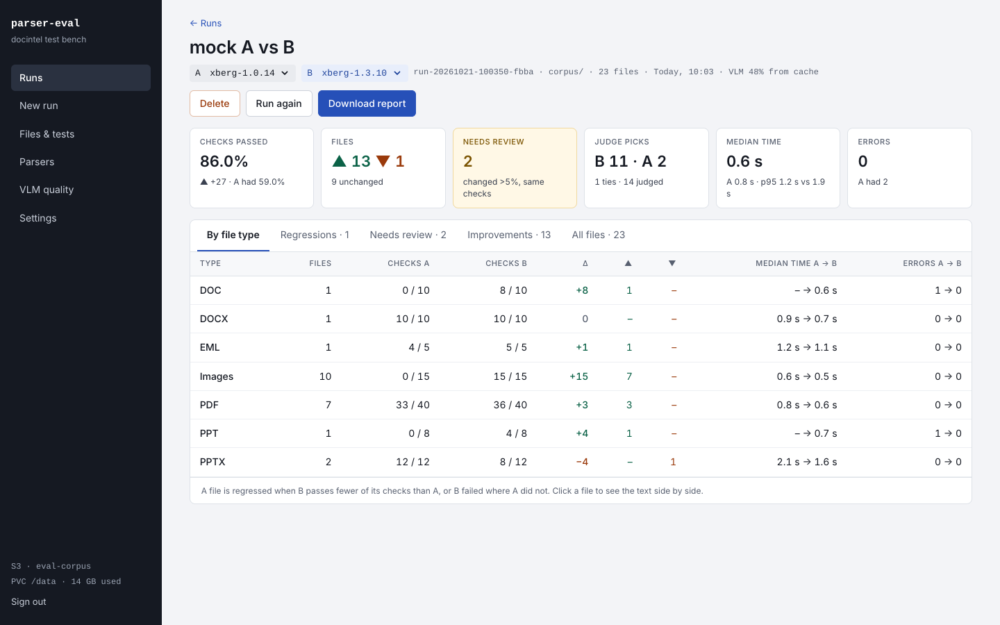
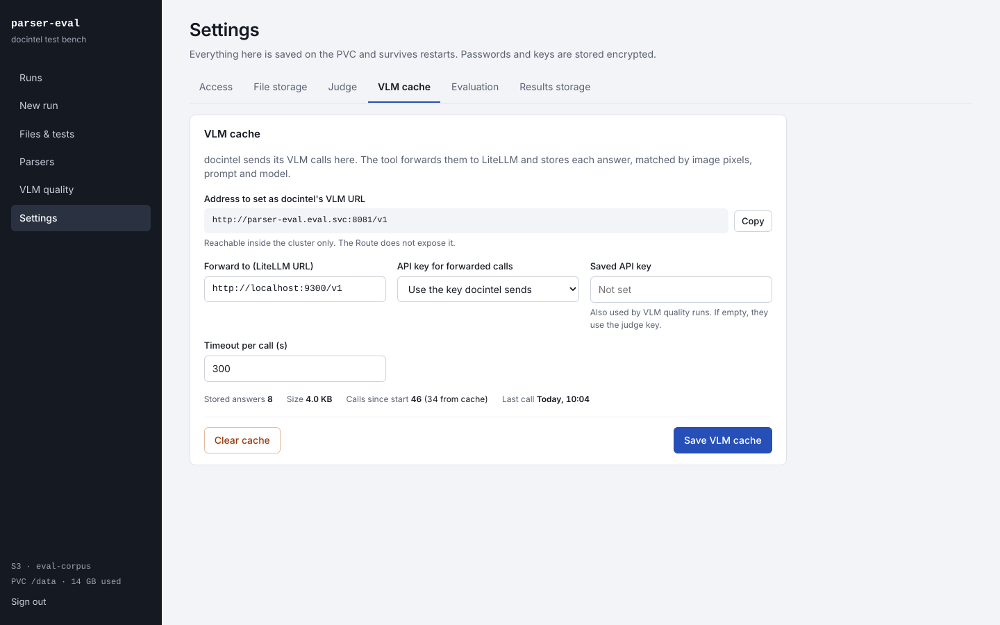
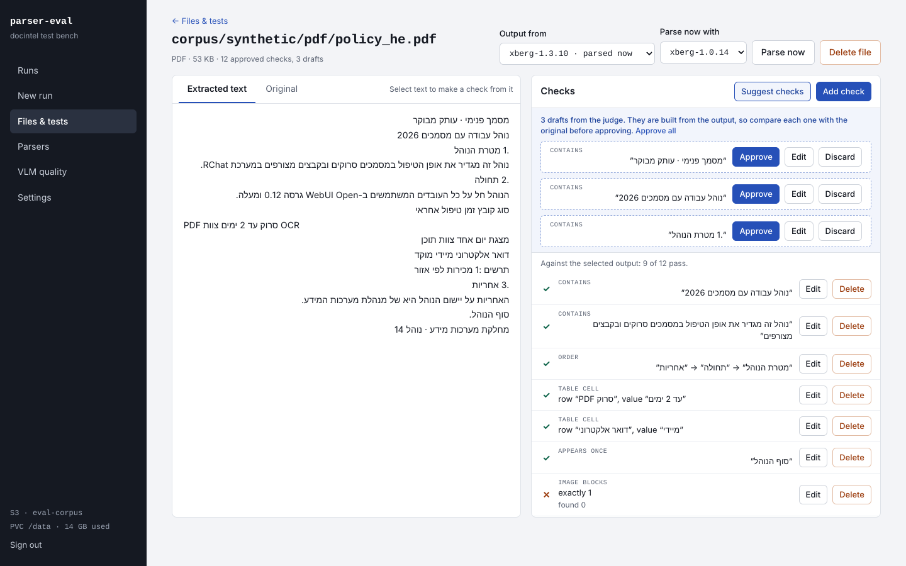
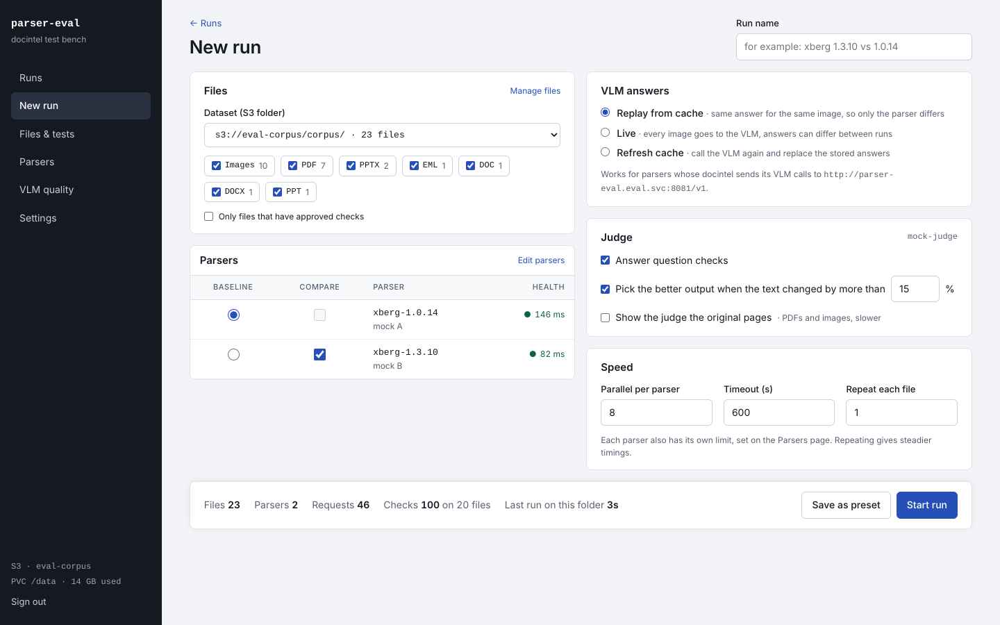
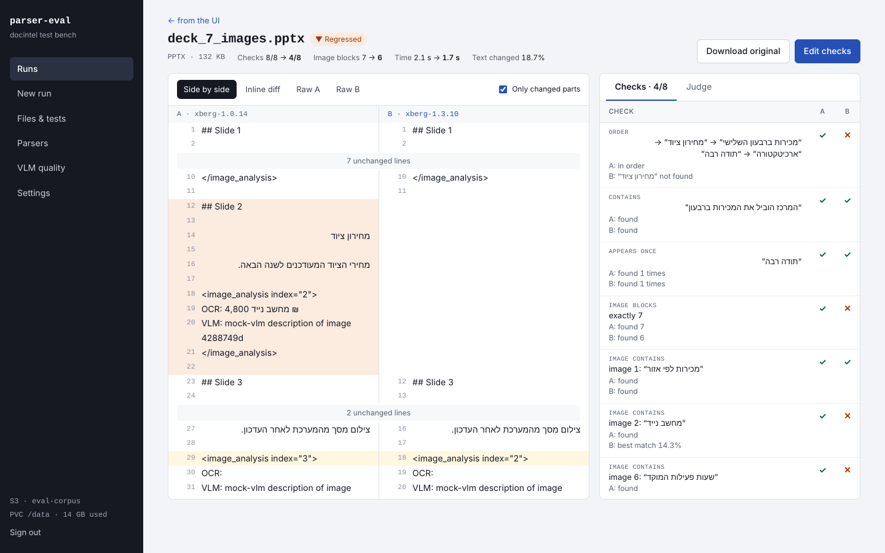
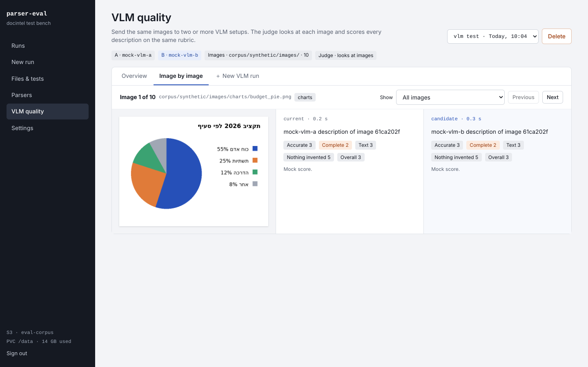

<div dir="rtl">

# parser-eval

[English](README.md) | **עברית**

parser-eval הוא כלי ווב להשוואה בין parsers של מסמכים מקצה לקצה, בדיוק כמו ש-Open WebUI משתמש בהם.
כל קובץ בתיקייה ב-S3 נשלח לשני מופעי parser או יותר (למשל docintel עם Xberg 1.0.14 ו-docintel עם
Xberg 1.3.10). אחר כך הכלי מראה אילו קבצים השתפרו, אילו נפגעו, מה בדיוק השתנה בטקסט, וכמה זמן לקח
לכל parser.

כדאי להריץ אותו לפני כל שדרוג של parser או של Xberg, ובכל פעם שרוצים לנסות parser אחר מאחורי docintel.



## תוכן העניינים

- [איך זה עובד](#איך-זה-עובד)
- [התקנה ב-OpenShift](#התקנה-ב-openshift)
- [הגדרה ראשונה](#הגדרה-ראשונה)
- [שימוש באפליקציה](#שימוש-באפליקציה)
  - [1. הוספת קבצי בדיקה](#1-הוספת-קבצי-בדיקה)
  - [2. כתיבת מבחנים](#2-כתיבת-מבחנים)
  - [3. הפעלת הרצה](#3-הפעלת-הרצה)
  - [4. קריאת התוצאות](#4-קריאת-התוצאות)
  - [5. בדיקת קובץ אחד](#5-בדיקת-קובץ-אחד)
  - [6. הורדת דוח](#6-הורדת-דוח)
  - [7. מדידת איכות ה-VLM](#7-מדידת-איכות-ה-vlm)
- [מתכון: לפני שדרוג Xberg](#מתכון-לפני-שדרוג-xberg)
- [מדריך להגדרות](#מדריך-להגדרות)
- [נתונים, גיבוי ושמירה](#נתונים-גיבוי-ושמירה)
- [אבטחה](#אבטחה)
- [פתרון בעיות](#פתרון-בעיות)
- [פיתוח](#פיתוח)

## איך זה עובד

<div dir="ltr">

```
             S3 bucket (test files)
                     │
               parser-eval  ──────────────►  judge model (LiteLLM)
              │           │
   POST /v1/convert/file  POST /v1/convert/file
              ▼           ▼
       docintel A      docintel B       (one instance per parser version)
              │           │
              └─ VLM calls ─►  parser-eval VLM cache (port 8081)  ──►  LiteLLM
```

</div>

המונחים שחוזרים באפליקציה:

| מונח | משמעות |
|---|---|
| **Parser** | מופע אחד של docintel, עם backend משלו (גרסה של Xberg, ‏Docling וכדומה). |
| **Run (הרצה)** | מעבר אחד על תיקיית קבצים, שבו כל קובץ נשלח לכל ה-parsers שנבחרו, במקביל. |
| **Baseline (A)** | ה-parser שמשווים אליו, בדרך כלל זה שבפרודקשן. |
| **Candidate (B)** | ה-parser שבודקים. בהרצה אחת אפשר לבדוק כמה. |
| **Check (מבחן)** | טענה קטנה של עובר/נכשל על הפלט של קובץ, למשל "המשפט הזה חייב להופיע". |
| **Judge (שופט)** | מודל שפה שעונה על מבחני שאלה, בוחר את הפלט הטוב יותר כשהטקסט השתנה הרבה, מציע מבחנים ונותן ציון לתיאורי VLM. |
| **VLM cache** | proxy שיושב לפני LiteLLM. הקריאות של docintel ל-VLM עוברות דרכו, כך ששני ה-parsers מקבלים את אותה תשובה לאותה תמונה, וההשוואה מראה רק את מה שה-parser שינה. |

הכלי שולח כל קובץ בדיוק כמו ש-Open WebUI שולח אותו ל-Docling: ‏`POST` מסוג multipart ל-`/v1/convert/file`,
עם פרמטרי ה-Docling שלך כשדות בטופס, וקורא את הטקסט מ-`document.md_content`. מה שרואים בכלי הוא מה
ש-Open WebUI היה מקבל.

הכול נשמר כקבצים על PVC: ההגדרות, ה-parsers, המבחנים, כל פלט של כל הרצה, והדוחות. שום דבר לא הולך
לאיבוד כשה-pod עולה מחדש, והרצה שנקטעה אפשר להמשיך.

## התקנה ב-OpenShift

### 1. בניית ה-image

ה-base image הוא `python:3.11-slim`. חבילות ה-Python ננעלו על גרסאות מתחילת 2024 (ראי `requirements.txt`),
כדי שגם מראה פנימי ישן יחזיק אותן. בזמן ריצה לא מורד שום דבר.

<div dir="ltr">

```bash
podman build -t parser-eval:1.0.0 \
  --build-arg BASE_IMAGE=<your-registry>/python:3.11-slim \
  --build-arg PIP_INDEX_URL=https://<your-mirror>/simple \
  --build-arg PIP_TRUSTED_HOST=<your-mirror-host> .
podman push parser-eval:1.0.0 <your-registry>/eval/parser-eval:1.0.0
```

</div>

ה-image רץ עם כל user ID בקבוצה 0 ועם מערכת קבצים לקריאה בלבד, כמו ש-OpenShift דורש.

### 2. הצפנת הסודות

ה-chart קורא שני סודות מ-SealedSecret:

| מפתח | למה הוא משמש |
|---|---|
| `APP_INITIAL_PASSWORD` | הסיסמה לכניסה הראשונה. מחליפים אותה אחר כך באפליקציה. |
| `APP_SECRET_KEY` | מפתח אקראי שמצפין את הסיסמאות ומפתחות ה-API שנשמרים בהגדרות, וחותם על ה-sessions. |

את שניהם יוצרים עם הסקריפט. הוא שואל על הסיסמה הראשונה, מייצר את המפתח, ומדפיס קטע values שבו שני
הערכים מוצפנים ל-namespace שלך:

<div dir="ltr">

```bash
./scripts/seal-secrets.sh <namespace> parser-eval-secrets <controller-namespace> <controller-name>
```

</div>

שמרי את הפלט כ-`values-prod.yaml`.

> אסור לשנות את `APP_SECRET_KEY` אחרי ההפעלה הראשונה. אם הוא משתנה, אי אפשר לפענח את המפתחות
> ששמורים בהגדרות, וצריך להקליד אותם מחדש.

### 3. התקנת ה-chart

<div dir="ltr">

```bash
helm upgrade --install parser-eval chart/parser-eval -n <namespace> \
  -f values-prod.yaml \
  --set image.repository=<your-registry>/eval/parser-eval \
  --set image.tag=1.0.0
```

</div>

מה ה-chart יוצר:

| אובייקט | הערות |
|---|---|
| Deployment | רפליקה אחת, אסטרטגיית `Recreate`, כי הנתונים יושבים על volume אחד מסוג ReadWriteOnce. |
| Service | פורט 8080 לממשק, פורט 8081 ל-VLM cache. |
| Route | רק פורט 8080, עם edge TLS כברירת מחדל. ה-VLM cache נשאר בתוך הקלאסטר. |
| PVC | ‏20Gi כברירת מחדל. נשאר גם אחרי `helm uninstall`. |
| SealedSecret | נשאר גם אחרי `helm uninstall`. |
| NetworkPolicy | אופציונלי (`networkPolicy.enabled`). מגביל מי יכול לפנות לפורט של ה-VLM cache. |

ערכים שכדאי להכיר: `persistence.size`, ‏`persistence.storageClass`, ‏`route.host`, ‏`networkPolicy.enabled`,
‏`resources`. כל הערכים מתועדים ב-`chart/parser-eval/values.yaml`.

## הגדרה ראשונה

פותחים את הכתובת של ה-Route, נכנסים עם הסיסמה שהצפנת, ועוברים פעם אחת על ההגדרות.



1. **Settings > Access.** מחליפים את הסיסמה.
2. **Settings > File storage.** כתובת ה-S3, ה-bucket, ה-access key וה-secret key. רוב שירותי ה-S3
   הפנימיים צריכים addressing מסוג *Path style*. אם הכתובת משתמשת ב-CA פנימי, מדביקים את תעודת ה-CA
   (או טוענים אותה מקובץ). לוחצים **Test connection**: הבדיקה מציגה את התוכן של ה-bucket, וגם כותבת
   ומוחקת קובץ בדיקה קטן, כי האפליקציה צריכה גם לקרוא וגם לכתוב.
3. **Settings > Judge.** כתובת ה-LiteLLM (למשל `http://litellm.<ns>.svc:4000/v1`), שם המודל ומפתח
   ה-API. אם המודל רואה תמונות, מסמנים **This model can see images**. לוחצים **Test judge**.
4. **Settings > VLM cache.** כתובת ה-LiteLLM שאליה יועברו קריאות ה-VLM. מעתיקים את הכתובת שמופיעה בראש
   הלשונית.
5. **בכל מופע docintel שרוצים לבדוק,** מגדירים את כתובת ה-VLM לכתובת הזו
   (`http://parser-eval.<namespace>.svc:8081/v1`). את מפתח ה-LiteLLM של docintel משאירים כמו שהוא,
   וה-cache מעביר אותו הלאה.
6. **Parsers.** מוסיפים parser לכל מופע docintel (פירוט בהמשך).
7. **Files & tests > Add sample set** מעלה 23 קבצי בדיקה מוכנים, כדי שיהיה ממה להתחיל.

### הוספת parser

נכנסים ל-**Parsers > Add parser** וממלאים:

| שדה | מה לכתוב |
|---|---|
| Name | שם קצר שתזהי בתוצאות, למשל `xberg-1.3.10`. |
| docintel URL | כתובת השירות, למשל `http://docintel-x1310.eval.svc:8080`. הכלי מוסיף לבד `/v1/convert/file`. |
| Authentication | ללא, bearer token, או header מותאם, אם docintel דורש. |
| Docling parameters | אותו JSON שמוגדר ב-`DOCLING_PARAMS` ב-Open WebUI. כל מפתח נשלח כשדה בטופס. |
| Text in the response | איפה הטקסט נמצא בתשובת ה-JSON. ברירת המחדל: `document.md_content`. |
| Send lists as | שדות חוזרים (ברירת המחדל, כמו ש-docling-serve מצפה) או מחרוזת JSON אחת. |
| Timeout, Max parallel | זמן מקסימלי לבקשה, וכמה בקשות המופע הזה מקבל במקביל. |

לוחצים **Test connection**. הבדיקה שולחת PDF קטן ומראה כמה זמן לקח וכמה טקסט חזר. הדרך המהירה להוסיף
גרסה נוספת היא **Duplicate**: מעתיקים, משנים את השם ואת הכתובת.

## שימוש באפליקציה

### 1. הוספת קבצי בדיקה

נכנסים ל-**Files & tests**. הקבצים יושבים ב-bucket ב-S3, מסודרים בתיקיות. כשמתחילים הרצה בוחרים
תיקייה, ולכן מבנה כזה עובד טוב:

<div dir="ltr">

```
corpus/
  synthetic/      the bundled sample set
  real/
    scans/
    office/
    email/
```

</div>

- **Upload files**, או גרירת קבצים לעמוד, מעלה אותם לתיקייה שפתוחה כרגע.
- **New folder** יוצר תיקייה ב-S3.
- **Add sample set** מעלה את קבצי הדוגמה הסינתטיים יחד עם המבחנים שלהם. הם מכסים מקרים שכבר נשברו
  בעבר: OCR בעברית, טקסט בשולי העמוד, שורות בכיוונים מעורבים, מצגת עם שבע תמונות שונות, לוגו שחוזר בכל
  שקופית, טקסט לבן על רקע שחור, חותמת שקופה, קבצי `.doc` ו-`.ppt` ישנים, מייל עם קבצים מצורפים, דוח של
  40 עמודים, אייקון זעיר ותמונה ריקה.
- הטבלה מראה לכל קובץ כמה מבחנים מאושרים וכמה טיוטות יש לו, מה הייתה התוצאה בהרצה האחרונה, ו-**File
  changed** כשהקובץ ב-S3 הוחלף אחרי שהמבחנים שלו נכתבו.

לחיצה על קובץ פותחת אותו בעורך המבחנים.

### 2. כתיבת מבחנים

מבחן הוא דבר אחד שחייב להיות נכון בפלט של קובץ. היום את בטח פותחת את הפלט ומחפשת דברים בעין. מבחן הוא
פשוט לכתוב את מה שאת מחפשת, כדי שהכלי יבדוק את זה בכל גרסה, בכל פעם.



עורך המבחנים מציג משמאל את הפלט של הקובץ (או את הקובץ המקורי, בלשונית **Original**), ומימין את
המבחנים. הסימן ליד כל מבחן מראה אם הוא עובר מול הפלט שנבחר למעלה.

**איך מקבלים פלט להסתכל עליו.** בוחרים ב-**Output from** פלט מהרצה קודמת, או בוחרים parser
ב-**Parse now with** ולוחצים **Parse now**.

**סוגי המבחנים:**

| סוג | עובר כש... | מתאים ל... |
|---|---|---|
| Contains | הטקסט מופיע. התאמה קרובה (90% דמיון כברירת מחדל) או מדויקת. | משפטי מפתח, מספרים, שמות. |
| Not contains | הטקסט לא מופיע. | placeholders שנשארו, כמו `<!-- image -->`, או זבל מוכר. |
| Order | החלקים מופיעים בסדר הזה. חלק אחד בכל שורה. | כותרות, סדר קריאה, שורות בכיוונים מעורבים. |
| Appears once | הטקסט מופיע פעם אחת בדיוק. | טקסט OCR כפול, שקופיות שחוזרות. |
| Image blocks | בפלט יש בדיוק (או לפחות) N בלוקים של ניתוח תמונה. | תמונות שנעלמו או הוכפלו. |
| Image contains | בלוק התמונה מספר N מכיל את הטקסט. | ניתוח תמונה שהגיע למקום הלא נכון. |
| Table cell | שורה אחת בטבלה, או שורה אחת בטקסט, מכילה גם את התווית וגם את הערך. | טבלאות, טפסים עם שדה וערך. |
| Question | השופט עונה על השאלה רק מתוך הפלט, והתשובה חייבת להתאים לשלך. | עובדות שאפשר לנסח בכמה דרכים. |

לפני ההשוואה מנרמלים את שני הצדדים: מסירים ניקוד, סימני כיווניות, סוגי מירכאות (׳ ״ ' ") ורווחים מיותרים,
ומשווים אותיות לטיניות בלי הבדל בין גדולות לקטנות.

**שלוש דרכים להוסיף מבחנים:**

1. **Add check** ומילוי הטופס.
2. **סימון טקסט** בפלט. מופיע כפתור שהופך את הטקסט המסומן למבחן *Contains*.
3. **Suggest checks.** השופט קורא את הפלט ומציע 6 עד 10 מבחנים כטיוטות. הטיוטות נבנות מהפלט, ולכן הן
   מעתיקות גם את הטעויות שלו. פותחים את הלשונית **Original**, משווים, ומאשרים רק טיוטות שנכונות לקובץ
   האמיתי. את השאר מוחקים.

**כמה מבחנים?** חמישה עד עשרה לקובץ מספיקים. כדאי לכסות את מה שהכי חשוב בקובץ הזה: הכותרת, משפט או
שניים מרכזיים, הסדר של הפרקים הראשיים, ערך מטבלה, מספר התמונות ושאלה אחת. מבחן שנכשל על פלט נכון גרוע
יותר מאין מבחן בכלל, ולכן לטקסט שעבר OCR עדיף להשתמש בהתאמה קרובה.

**כשקובץ משתנה ב-S3,** המבחנים שלו מסומנים. עוברים עליהם, ואז לוחצים **mark them as current**.

כל הרצה מקפיאה את המבחנים כפי שהיו כשהיא התחילה, ולכן עריכה מאוחרת של מבחנים לא משנה תוצאות של
הרצות קודמות.

### 3. הפעלת הרצה

נכנסים ל-**New run**.



| חלק | מה בוחרים |
|---|---|
| Run name | שם שתזהי אחר כך, למשל `xberg 1.3.10 vs 1.0.14`. |
| Files | התיקייה ב-S3 (כולל כל תתי-התיקיות), סוגי הקבצים, ואם רוצים, רק קבצים שיש להם מבחנים מאושרים. |
| Parsers | **Baseline** אחד ו-parser אחד או יותר ל-**Compare**. עמודת ה-Health מראה אם כל אחד מהם עונה. |
| VLM answers | **Replay from cache** (מומלץ): תמונה שה-cache כבר ראה מקבלת את התשובה השמורה, ותמונה חדשה נשלחת ל-VLM פעם אחת. **Live**: כל תמונה נשלחת ל-VLM, ולכן התשובות יכולות להשתנות בין הרצות. **Refresh cache**: שולחים שוב ל-VLM ומחליפים את התשובות השמורות. |
| Judge | **Answer question checks**. **Pick the better output** לקבצים שהטקסט שלהם השתנה מעבר לסף. **Show the judge the original pages** (‏PDF ותמונות, איטי יותר, ודורש מודל שרואה תמונות). |
| Speed | בקשות במקביל לכל parser, זמן מקסימלי לקובץ, וכמה פעמים לשלוח כל קובץ (3 נותן מדידות זמן יציבות יותר). |

הסרגל בתחתית מראה כמה קבצים, בקשות ומבחנים יהיו בהרצה. **Save as preset** שומר את הבחירות לפעם הבאה,
וגם **Run again** בהרצה שהסתיימה עושה את אותו הדבר.

ההרצות נכנסות לתור ורצות אחת אחרי השנייה, וכל אחת מהן מקבילית מאוד בפנים. אפשר לעזוב את העמוד, וההרצה
ממשיכה בשרת. אם ה-pod עולה מחדש, ההרצה מסומנת *Interrupted*, ו-**Resume** ממשיך מהקובץ האחרון שהסתיים.

### 4. קריאת התוצאות

פותחים הרצה מתוך **Runs**. למעלה, **A** ו-**B** קובעים אילו שני parsers משווים (שימושי כשיש בהרצה כמה
מועמדים).

השורה העליונה:

| ריבוע | משמעות |
|---|---|
| Checks passed | אחוז המבחנים ש-B עובר, וההפרש מ-A. |
| Files ▲ ▼ | קבצים שהשתפרו ושנפגעו. |
| Needs review | קבצים שהמבחנים שלהם לא השתנו, אבל הטקסט שלהם השתנה מעבר לסף. |
| Judge picks | בקבצים שעברו את הסף, כמה פעמים כל צד נבחר כטוב יותר (השאלה נשאלת בשני הסדרים). |
| Median time | חציון השניות לקובץ ב-B, לצד A והאחוזון ה-95. |
| Errors | בקשות שנכשלו ו-timeouts. |

קובץ **נפגע** (regressed) כש-B עובר פחות מבחנים שלו מ-A, או כש-B נכשל במקום ש-A הצליח. **השתפר**
(improved) הוא המקרה ההפוך.

הלשוניות מתחת לשורה העליונה:

- **By file type:** מבחנים, שינויים, זמנים ושגיאות לפי סוג קובץ: PDF, ‏DOCX, ‏PPTX, תמונות וכן הלאה.
- **Regressions:** הקבצים שצריך לטפל בהם לפני שדרוג. עמודת הפרטים מפרטת את המבחנים שנכשלים עכשיו.
- **Needs review:** הטקסט השתנה הרבה, אבל אף מבחן לא שם לב. כדאי להסתכל עליהם בעין, ולהוסיף מבחנים למה
  שמוצאים.
- **Improvements** ו-**All files**.

### 5. בדיקת קובץ אחד

לוחצים על קובץ בכל אחת מהרשימות.



- **Side by side:** ‏A ו-B מיושרים שורה מול שורה. אדום קיים רק ב-A, ירוק רק ב-B, צהוב השתנה. **Only
  changed parts** מסתיר קטעים ארוכים שלא השתנו.
- **Inline diff**, ‏**Raw A**, ‏**Raw B:** תצוגות אחרות של אותם פלטים.
- **Checks:** כל מבחן עם התוצאה שלו ב-A וב-B, ולמה הוא נכשל. במבחני שאלה רואים גם את התשובה של השופט.
- **Judge:** ההכרעה, הנימוק שלה, והנימוק מהסדר ההפוך.
- **Edit checks** פותח את הקובץ בעורך המבחנים, ו-**Download original** מוריד אותו מ-S3.

### 6. הורדת דוח

**Download report** בהרצה שומר קובץ HTML אחד עם השורה העליונה, הטבלה לפי סוג קובץ, כל קובץ שנפגע וכל
קובץ שצריך בדיקה עם ה-diff של הטקסט שלו, ורשימת כל הקבצים. הוא נפתח בכל דפדפן גם בלי האפליקציה, כך שאפשר
לצרף אותו לטיקט או לבקשת שדרוג.

### 7. מדידת איכות ה-VLM

**VLM quality** הוא מסלול נפרד שבודק את ה-VLM עצמו, בלי קשר ל-parser.



1. שמים תמונות בתיקייה ב-S3. כדאי לחלק לתתי-תיקיות לפי סוג תמונה (`charts/`, ‏`scans/`, ‏`photos/`),
   כי התוצאות מקובצות לפיהן.
2. נכנסים ל-**VLM quality > New VLM run**, בוחרים את התיקייה ומוסיפים שתי הגדרות או יותר: שם, מודל
   ב-LiteLLM, פרומפט, גודל מקסימלי לצלע הארוכה, והאם לשים רקע לבן מתחת לשקיפות.
3. כל הגדרה מתארת כל תמונה דרך LiteLLM. אם השופט רואה תמונות, הוא נותן לכל תיאור ציון מ-1 עד 5 על
   דיוק, שלמות, קריאת הטקסט, הימנעות מהמצאות, וציון כללי. הוא רואה תיאור אחד בכל פעם ולא יודע איזו הגדרה
   כתבה אותו.
4. **Overview** מציג ממוצעים, השוואה ראש בראש, וציונים לפי סוג תמונה. **Image by image** מציג את
   התמונה ליד כל התיאורים והציונים שלהם, עם מסננים כמו *Where the second setup is worse*.

## מתכון: לפני שדרוג Xberg

1. מרימים docintel שני עם הגרסה החדשה של Xberg, ליד הקיים. מגדירים בשניהם את כתובת ה-VLM לכתובת
   ה-VLM cache של parser-eval.
2. מוסיפים את שניהם כ-parsers. משכפלים את הקיים ומשנים כתובת ושם.
3. מפעילים הרצה על כל תיקיית הבדיקות: baseline הוא הקיים, candidate הוא החדש, **Replay from cache**,
   והשופט פעיל.
4. קודם קוראים את **Regressions**. כל קובץ שנפגע הוא סיבה לא לשדרג עדיין, או מבחן שצריך לעדכן כי הפלט
   החדש בעצם טוב יותר.
5. אחר כך קוראים את **Needs review**, ומוסיפים מבחנים למה שמוצאים שם.
6. מורידים את הדוח ומצרפים אותו להחלטה על השדרוג.
7. אחרי תיקון הגדרות (למשל שפת ה-OCR או הגדרות התמונות), מריצים שוב. עם **Replay from cache** תשובות
   ה-VLM נשארות זהות, כך שההבדל הוא רק ה-parser.

## מדריך להגדרות

| לשונית | שדות |
|---|---|
| Access | החלפת סיסמה, כמה זמן נשארים מחוברים, ניתוק כל הדפדפנים. |
| File storage | כתובת S3, ‏bucket, תיקיית שורש (רק קבצים מתחתיה בשימוש), access key, ‏secret key, אזור, סוג addressing, אימות TLS, ותעודת CA פנימית. אותה תעודה משמשת גם מול docintel, ‏LiteLLM והשופט. |
| Judge | כתובת LiteLLM, מודל, מפתח API, מגבלת context בטוקנים (מסמכים ארוכים נחתכים באמצע כדי להיכנס), קריאות במקביל לשופט, temperature, ‏timeout, והאם הוא רואה תמונות. |
| VLM cache | הכתובת ל-docintel, כתובת LiteLLM להעברה, באיזה מפתח להשתמש (זה ש-docintel שולח, או מפתח שנשמר כאן), ‏timeout, סטטיסטיקות, ו-Clear cache. המפתח השמור משמש גם בהרצות VLM quality (ואם הוא ריק, משתמשים במפתח של השופט). |
| Evaluation | שם התגית שבה docintel עוטף ניתוח תמונה (ברירת מחדל `image_analysis`), סף השינוי ברירת המחדל לשופט ול-*Needs review*, וסף ההתאמה הקרובה. |
| Results storage | השימוש בנפח ה-PVC לפי חלקים, וכמה זמן לשמור פלטים של הרצות. |

סיסמאות ומפתחות API נשמרים מוצפנים עם `APP_SECRET_KEY`, ולעולם לא נשלחים חזרה לדפדפן. שדה שמציג
*Saved · type to replace* שומר על הערך שלו, אלא אם מקלידים ערך חדש.

## נתונים, גיבוי ושמירה

<div dir="ltr">

```
/data/config/     settings.json, parsers.json, auth.json, presets.json, ca.pem
/data/checks/     one JSON file per S3 file
/data/runs/       one folder per run: run.json, results/<parser>/<file>.json (full text),
                  judge/, and the checks frozen at the start of the run
/data/vlm-cache/  cached VLM answers
/data/vlm-runs/   VLM quality runs
/data/outputs/    "Parse now" outputs and the latest result per file
```

</div>

לגיבוי מעתיקים את `/data` (למשל עם VolumeSnapshot או `oc rsync`). כל הקבצים הם JSON פשוט ונכתבים בבת
אחת, כך שהעתקה בזמן שהאפליקציה רצה עקבית ברמת הקובץ.

**Settings > Results storage > Keep run outputs** מוחק הרצות ישנות אוטומטית, ו-*Delete older runs now*
מפעיל את זה מיד. מבחנים, הגדרות וה-VLM cache לעולם לא נמחקים אוטומטית.

## אבטחה

- סיסמה משותפת אחת, שנשמרת כ-hash מסוג scrypt. אחרי סיסמה שגויה, ניסיונות נוספים מאותה כתובת מואטים.
- ה-sessions הם cookies חתומים, ומסומנים Secure כשה-Route משתמש ב-TLS. **Sign out all browsers** מבטל
  את כל ה-sessions.
- ה-VLM cache בפורט 8081 פתוח בלי סיסמה, כי docintel פונה אליו. ה-Route לא חושף אותו. אם שומרים בכלי
  מפתח VLM, כדאי להפעיל את `networkPolicy` ב-chart, כך שרק מופעי ה-docintel של הבדיקה יוכלו לפנות אליו.
- טקסט שחולץ מקבצים נשלח לשופט בתוך תגיות, עם הוראה להתייחס אליו כמידע ולא כהוראות.

## פתרון בעיות

| תסמין | מה לבדוק |
|---|---|
| *S3 is not set up yet* | ‏Settings > File storage, ואז Test connection. |
| בדיקת S3 נכשלת עם שגיאת תעודה | מדביקים את ה-CA הפנימי ב-Settings > File storage, או מבטלים זמנית את Verify TLS לבדיקה. |
| בדיקת S3 נכשלת עם *SignatureDoesNotMatch* או *NoSuchBucket* | לרוב זה סוג ה-addressing: נסי *Path style*. בדקי גם את האזור. |
| parser מסומן *Not reachable* | הכתובת צריכה להיות נגישה מה-pod של parser-eval. אפשר להיכנס ל-pod עם `oc rsh` ולנסות `curl` לכתובת. |
| כל הקבצים נכשלים עם *No text at document.md_content* | לתשובה יש מבנה אחר. מסתכלים על תשובה אחת ומעדכנים את *Text in the response*. |
| ‏*HTTP 422* מ-docintel | לפרמטר Docling יש פורמט שגוי. נסי *Send lists as: JSON text*. |
| ה-VLM cache מראה 0% מה-cache | ‏docintel לא משתמש בכתובת ה-cache ככתובת ה-VLM שלו, או שהתמונות שונות בפיקסלים בין הגרסאות. |
| timeouts בקבצים גדולים | מעלים את ה-timeout ב-parser ובהרצה, ובודקים את ה-timeout של ה-Route (`haproxy.router.openshift.io/timeout`). |
| שגיאות שופט בתוצאות | ‏Settings > Judge > Test judge. בודקים את שם המודל ב-LiteLLM ואת מגבלת ה-context. |
| הרצה מסומנת *Interrupted* | ה-pod עלה מחדש. לוחצים Resume, והקבצים שכבר הסתיימו נשמרים. |

הלוג של ה-pod (`oc logs deploy/parser-eval`) מציג משימות שנכשלו עם ה-stack trace שלהן.

## פיתוח

<div dir="ltr">

```
app/        FastAPI backend: UI and API on 8080, VLM cache on 8081
static/     Browser UI, plain HTML, CSS and JavaScript, no build step, nothing loaded from the internet
samples/    The synthetic test set and its checks
chart/      Helm chart for OpenShift
scripts/    seal-secrets.sh
tools/      gen_samples.py rebuilds the samples; mock_services.py fakes docintel and LiteLLM
tests/      Unit tests
```

</div>

הרצה מקומית מלאה עם שירותים מדומים:

<div dir="ltr">

```bash
pip install -r requirements.txt "moto[server]==5.0.5" python-docx python-pptx
moto_server -p 9100 &
python tools/mock_services.py litellm --port 9300 &
python tools/mock_services.py docintel --variant a --port 9201 --vlm http://localhost:8081/v1 &
python tools/mock_services.py docintel --variant b --port 9202 --vlm http://localhost:8081/v1 &
DATA_DIR=./data APP_SECRET_KEY=dev APP_INITIAL_PASSWORD=dev-pass-1 python -m app.main
```

</div>

פותחים את http://localhost:8080 ונכנסים עם `dev-pass-1`. קודם יוצרים את ה-bucket ב-moto (למשל
`aws --endpoint-url http://localhost:9100 s3 mb s3://eval-corpus`, עם המפתחות `test`/`test`). אחר כך
משתמשים ב-`http://localhost:9100` ל-S3, ב-`http://localhost:9300/v1` לשופט ול-VLM, וב-`http://localhost:9201`
וב-`http://localhost:9202` כשני parsers. ה-docintel המדומה הוא כלי בדיקה ולא parser: גרסה b שונה מגרסה a
בכוונה, כדי שלהשוואה יהיה מה להראות.

בדיקות יחידה: `python -m pytest tests`. כדי לבנות מחדש את סט הדוגמה (צריך LibreOffice ופונט עם עברית):
`python tools/gen_samples.py`.

</div>
